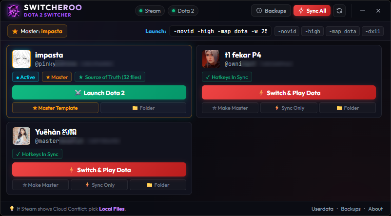

# 🔄 Switcheroo

> **1-Click Steam Account Switcher & Dota 2 Settings Synchronizer**  
> Effortlessly switch Steam accounts and clone your Dota 2 hotkeys, quickcasts, chat wheels, and preferences across all your accounts.

<p align="center">
  
</p>

---

## 📥 Downloads (Latest Release v1.0.0)

Choose the format that works best for your setup from the [Releases Page](https://github.com/Mightyiest/Switcheroo/releases/tag/v1.0.0):

| Package | Description | Best For |
|---|---|---|
| 💻 **[Switcheroo-Setup-v1.0.0.exe](https://github.com/Mightyiest/Switcheroo/releases/download/v1.0.0/Switcheroo-Setup-v1.0.0.exe)** | **Standard Windows Installer** with desktop/start shortcuts & choice of directory | Everyday gaming PC use (instant launch) |
| ⚡ **[Switcheroo-v1.0.0-win64.zip](https://github.com/Mightyiest/Switcheroo/releases/download/v1.0.0/Switcheroo-v1.0.0-win64.zip)** | **Standalone Folder Archive** (extract & run `Switcheroo.exe` directly) | USB flash drives, custom gaming directories (< 150ms boot) |
| 📦 **[Switcheroo-Portable-v1.0.0.exe](https://github.com/Mightyiest/Switcheroo/releases/download/v1.0.0/Switcheroo-Portable-v1.0.0.exe)** | **Single-File Portable Executable** with extraction caching | Single-file portability |

---

## ⚡ Overview

Switching between multiple Steam accounts often resets your Dota 2 hotkeys, item slots, console binds, and chat wheels, forcing you to reconfigure settings manually or suffer through missed keys in-game.

**Switcheroo** solves this by:
1. Detecting all saved Steam accounts on your PC.
2. Designating a **Master Template** account as your source of truth.
3. Synchronizing hotkeys and settings directly to other accounts in 1 click.
4. Switching active Steam login and launching Dota 2 seamlessly.

---

## ✨ Features

- 🚀 **1-Click Switch & Play**: Switches the active Steam profile and automatically launches Dota 2 with your custom launch flags.
- ⚡ **Direct Launch Bypass**: If you are already logged into the selected account, launches Dota 2 instantly without restarting Steam.
- 🔄 **Precision Hotkey & Settings Sync**:
  - Main hotkeys & quickcast binds (`dotakeys_personal.lst`)
  - Console binds & autoexec commands (`user_keys.vcfg`)
  - Game options, camera settings & chat wheels (`user_convars.vcfg`)
  - Hero builds & hero facet configs (`herobuilds.cfg`, `hero_facet_config.cfg`)
  - Control groups & suggested items (`control_groups.txt`, `item_suggest_preference.txt`)
- 🛡️ **Zero-Risk Automated Backups**: A full timestamped backup is generated automatically before any sync or restore action.
- 📦 **1-Click Restore**: Easily roll back settings on any account from the built-in backups manager.
- ⚙️ **Launch Option Chips**: Click-to-add launch arguments (`-novid`, `-high`, `-map dota`, `-dx11`).
- 🎨 **Sleek Modern UI**: Frameless dark-themed interface with live Steam detection, active user pills, and account avatar caching.

---

## 🧠 How It Works Under the Hood

### 1. Automatic Account Discovery
Switcheroo queries the Windows Registry (`HKCU\Software\Valve\Steam`) in a single pass to locate your `SteamPath` and `SteamExe`. It then parses `Steam/config/loginusers.vdf` to extract saved accounts, calculates their 32-bit `SteamID3` from `SteamID64`, and grabs local avatar caches.

### 2. Intelligent Steam Cloud Synchronization
When copying settings between accounts, Steam Cloud often causes sync collisions or overwrites local files with stale cloud data. Switcheroo avoids this through deliberate design:
- Copies **only safe user settings files** from `userdata/<MasterSteamID3>/570/` to `userdata/<AltSteamID3>/570/`.
- **Leaves `remotecache.vdf` untouched on the target account**: Because the cloud cache index is unchanged while the local files have updated modification timestamps, Steam Cloud detects the settings as "locally modified" and **uploads** them to the cloud rather than pulling down old binds.

### 3. Safe Account Switching
- Closes running Steam instances cleanly before touching registry or userdata files.
- Updates Windows Registry `AutoLoginUser` and `RememberPassword` via secure, isolated process vectors (`spawnSync`).
- Updates `loginusers.vdf` using **atomic writes** (`.tmp` -> rename) to eliminate any risk of file corruption if an interruption occurs.
- Spawns Steam with `-applaunch 570 <launch_options>` detached.

---

## 📖 Step-by-Step Guide: How to Use

### Step 1: Launch Switcheroo
- Double-click **`Launch-Switcheroo.bat`** (or run `npm start` in the terminal).
- Verify the **Steam** and **Dota 2** status pills in the top-right header display green.

### Step 2: Choose Your Master Template
- Find the account card containing your ideal hotkeys and settings.
- Click **`☆ Make Master`**.
- This account is now your **Source of Truth** (indicated with a gold ★ badge).

### Step 3: Switch & Launch
- On any account card:
  - If it is already logged in: Click **`⚔️ Launch Dota 2`** to jump straight into the game.
  - If it is an alt account: Click **`⚡ Switch & Play Dota`**. Switcheroo will automatically snapshot existing settings, sync your Master binds, switch your active Steam account, and launch Dota 2.

### Step 4: Sync Without Launching (Optional)
- Want to update settings on an alt without opening the game? Click **`⚡ Sync Only`** on the account card.
- Want to update *all* your accounts at once? Click the **`Sync All`** button in the top navigation bar.

### Step 5: Restoring a Backup
- If you ever need to restore previous hotkeys:
  1. Click **`Backups`** in the header.
  2. Locate the timestamped backup for the account.
  3. Click **`Restore`** and confirm.

---

## 💡 Important Notices

### 1. Windows SmartScreen / Smart App Control ("Unknown Publisher")
Because Switcheroo is a brand-new, open-source project without an expensive ($400/yr) commercial Microsoft EV code-signing certificate, Windows 11 Smart App Control or Defender SmartScreen may show an *"Unable to verify publisher"* or *"Windows protected your PC"* prompt on downloaded binaries.

**How to bypass in 5 seconds:**
* **Option A (Properties)**: Right-click `Switcheroo-Portable-v1.0.0.exe` ➔ Click **Properties** ➔ Check the **Unblock** box at the bottom right ➔ Click **OK**.
* **Option B (SmartScreen Prompt)**: Click **More info** ➔ Click **Run anyway**.
* **Option C (PowerShell)**: Run `Unblock-File -Path .\Switcheroo-Portable-v1.0.0.exe`.

### 2. Steam Cloud Conflict Notice
If Steam displays a **"Cloud Conflict"** prompt when launching Dota 2:
> **Always select `Upload Local Files` / `Use Local Files`**  
> This instructs Steam to keep the freshly synchronized hotkeys from Switcheroo and push them to your Steam Cloud.

---

## 🛠️ Installation & Development

### Prerequisites
- **Windows 10 / 11**
- **[Node.js](https://nodejs.org/)** (v18 or higher recommended)
- **Steam** and **Dota 2** installed

### Clone & Run
```bash
# Clone repository
git clone https://github.com/Mightyiest/Switcheroo.git

# Enter project directory
cd Switcheroo

# Install dependencies
npm install

# Start the application
npm start
```

Or simply run `Launch-Switcheroo.bat`.

---

## 🔒 Security & Privacy

- **100% Local**: No network requests or telemetry. Switcheroo runs strictly on your machine.
- **No Password Access**: Uses Steam's native registry remember-me keys (`AutoLoginUser`). Switcheroo never handles or asks for your Steam passwords.
- **Content Security Policy (CSP)**: Hardened with context isolation and explicit security boundaries between the Electron main process and DOM renderer.

---

## 📄 License

ISC License. Made for Dota 2 players with multiple accounts.
