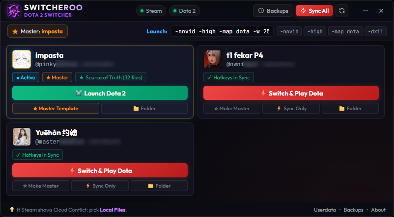

<div align="center">

# 🔄 Switcheroo

**1-Click Steam Account Switcher & Dota 2 Settings Synchronizer (v2.0.0 — 100% Native Rust)**  
Effortlessly switch Steam accounts and clone your Dota 2 hotkeys, quickcasts, chat wheels, and preferences across all your accounts — rewritten in **100% Pure Rust** with a native GPU UI & native Rust installer (zero Electron, Node.js, or WebView2 bloat).

[](Cargo.toml)
[](https://www.virustotal.com/gui/file/b32ea600e6703a82f2a59e2c9ad80bf6c60878338dad561af9c4f7420a0335d5)
[](LICENSE)
[](https://github.com/Mightyiest/Switcheroo/releases)

[🌐 **Official Project Page (GitHub Pages)**](https://mightyiest.github.io/Switcheroo/) • [📦 **Releases**](https://github.com/Mightyiest/Switcheroo/releases) • [🔍 **Inspect Rust Source**](src/)



</div>

---

## 📥 Downloads & VirusTotal (by Google) Verification (v2.0.0 — Pure Rust)

Choose the format that works best for your setup from the [Releases Page](https://github.com/Mightyiest/Switcheroo/releases) (or build locally with `.\Build-Release.ps1`):

| Package | Size | VirusTotal (by Google) | Best For |
|---|---|---|---|
| 💻 **[Switcheroo-Setup-v2.0.0.exe](https://github.com/Mightyiest/Switcheroo/releases/download/v2.0.0/Switcheroo-Setup-v2.0.0.exe)** | `9.97 MB` | [🔍 View VirusTotal Report](https://www.virustotal.com/gui/file/b32ea600e6703a82f2a59e2c9ad80bf6c60878338dad561af9c4f7420a0335d5) | **Pure Rust Windows Installer** with Desktop/Start Menu shortcuts & 1-click Windows uninstall |
| 📦 **[Switcheroo-Portable-v2.0.0.exe](https://github.com/Mightyiest/Switcheroo/releases/download/v2.0.0/Switcheroo-Portable-v2.0.0.exe)** | `6.95 MB` | [🔍 View VirusTotal Report](https://www.virustotal.com/gui/file/66025334290d4af76d092766c74bbdb35dca7025cca5973157ecbc0033c325ed) | **Single-File Portable Executable** (no install, instant launch) |
| ⚡ **[Switcheroo-v2.0.0-win64.zip](https://github.com/Mightyiest/Switcheroo/releases/download/v2.0.0/Switcheroo-v2.0.0-win64.zip)** | `3.45 MB` | [🔍 View VirusTotal Report](https://www.virustotal.com/gui/file/a0a8f4b554fd4e624948deea75871f41c54594f64c65a37cf9f921b323f9e7fa) | **Standalone Archive** (`Switcheroo.exe`, `README.md`, `LICENSE`) |

### Binary SHA-256 Checksums
```text
Switcheroo-Setup-v2.0.0.exe     b32ea600e6703a82f2a59e2c9ad80bf6c60878338dad561af9c4f7420a0335d5
Switcheroo-Portable-v2.0.0.exe  66025334290d4af76d092766c74bbdb35dca7025cca5973157ecbc0033c325ed
Switcheroo-v2.0.0-win64.zip     a0a8f4b554fd4e624948deea75871f41c54594f64c65a37cf9f921b323f9e7fa
```
*(The SHA-256 for `Switcheroo-v2.0.0-win64.zip` is published in `SHA256SUMS.txt` on the release and on the [GitHub Pages Security section](https://mightyiest.github.io/Switcheroo/#security).)*

---

## 🛡️ Transparency, Open-Source Trust & VirusTotal

Switcheroo is **100% free, open source ([ISC License](LICENSE)), and written completely in memory-safe native Rust**:
- **Zero Telemetry or Network Requests**: Switcheroo never opens sockets, phones home, or checks remote servers. Inspect every `.rs` file in [`src/`](src/) and [`src/bin/installer.rs`](src/bin/installer.rs).
- **Zero Password Handling**: Uses Steam's native local registry auto-login keys (`HKCU\Software\Valve\Steam\AutoLoginUser`), never touching credentials.
- **No Hidden Subprocess Shells**: Uses native Win32 APIs (`winreg`, `windows-sys`, `windows` COM `IShellLinkW`) instead of spawning `cmd.exe` / PowerShell scripts during Steam discovery, shortcut creation, or switching.
- **Reproducible CI & GitHub Build Attestations**: [`.github/workflows/release.yml`](.github/workflows/release.yml) compiles directly from this repository on GitHub-hosted `windows-latest` runners and generates cryptographic [GitHub Build Provenance Attestations](https://docs.github.com/en/actions/security-for-github-actions/using-artifact-attestations/using-artifact-attestations-to-establish-provenance-for-builds).

### Verify Before Running (PowerShell)
```powershell
# 1. Check the local SHA-256 hash matches the published checksum above:
Get-FileHash .\Switcheroo-Setup-v2.0.0.exe -Algorithm SHA256

# 2. Optional: Verify GitHub Build Provenance Attestation using GitHub CLI:
gh attestation verify .\Switcheroo-Setup-v2.0.0.exe --repo Mightyiest/Switcheroo
```

---

## ⚡ Overview

Switching between multiple Steam accounts often resets your Dota 2 hotkeys, item slots, console binds, and chat wheels, forcing you to reconfigure settings manually or suffer through missed keys in-game.

**Switcheroo** solves this by:
1. Detecting all saved Steam accounts on your PC.
2. Designating a **Master Template** account as your source of truth.
3. Synchronizing hotkeys and settings directly to other accounts in 1 click.
4. Switching active Steam login and launching Dota 2 seamlessly.

---

## ✨ Features

- 🦀 **100% Pure Native Rust UI (`egui` / `eframe`)**: GPU-rendered dark interface with instant startup, minimal footprint (`6.95 MB` standalone `.exe`), and zero Electron/WebView2 runtime dependencies.
- 💻 **Native Rust Windows Installer (`Switcheroo-Setup`)**: Custom dark-theme setup wizard with gzip-compressed payload extraction, Desktop/Start Menu `.lnk` shortcuts via Windows COM, and clean Windows Installed Apps uninstall support.
- 🚀 **1-Click Switch & Play**: Switches the active Steam profile and automatically launches Dota 2 with your custom launch flags.
- ⚡ **Direct Launch Bypass**: If you are already logged into the selected account with Steam running, launches Dota 2 instantly without restarting Steam.
- 🔄 **Precision Hotkey & Settings Sync**:
  - Main hotkeys & quickcast binds (`dotakeys_personal.lst`)
  - Console binds & autoexec commands (`user_keys.vcfg`)
  - Game options, camera settings & chat wheels (`user_convars.vcfg`)
  - Hero builds & hero facet configs (`herobuilds.cfg`, `hero_facet_config.cfg`)
  - Control groups & suggested items (`control_groups.txt`, `item_suggest_preference.txt`)
  - Local slot key/convar configs & video settings (`user_keys_*_slot*.vcfg`, `user_convars_*_slot*.vcfg`, `machine_convars.vcfg`, `video.txt`)
- 🛡️ **Zero-Risk Automated Backups**: A selective allowlisted backup (`+ remotecache.vdf`) is generated automatically before any sync or restore action (unless settings already match), retaining the latest 10 snapshots per account.
- 📦 **1-Click Restore**: Easily roll back settings on any account from the built-in backups manager.
- ⚙️ **Launch Option Chips**: Click-to-add launch arguments (`-novid`, `-high`, `-map dota`, `-dx11`).
- 🔒 **Single-Instance Guard**: Named Windows mutex focuses the existing window if Switcheroo is launched again.

---

## 🧠 How It Works Under the Hood

### 1. Automatic Account Discovery
Switcheroo queries the Windows Registry (`HKCU\Software\Valve\Steam`) directly via Win32 APIs (`winreg`) to locate `SteamPath`, `SteamExe`, `AutoLoginUser`, and live `ActiveProcess\ActiveUser` (when Steam is running, falling back to standard drive install paths). It parses `Steam/config/loginusers.vdf` to extract saved accounts, computes 32-bit `SteamID3` from `SteamID64`, decodes cached avatars off-thread, and verifies hotkey parity via domain-separated SHA-1 hashes.

### 2. Intelligent Steam Cloud Synchronization
When copying settings between accounts, Steam Cloud often causes sync collisions or overwrites local files with stale cloud data. Switcheroo avoids this through deliberate design:
- Copies **only allowlisted user settings files** from `userdata/<MasterSteamID3>/570/` to `userdata/<AltSteamID3>/570/` and verifies SHA-1 parity on every copied file.
- **Leaves `remotecache.vdf` untouched on the target account**: Because the cloud cache index is unchanged while the local files have updated modification timestamps, Steam Cloud detects the settings as "locally modified" and **uploads** them to the cloud rather than pulling down old binds.

### 3. Safe Native Account Switching
- Checks running `dota2.exe` and `steam.exe` processes silently via Win32 Toolhelp32 snapshots (`windows-sys`) with zero console flashes.
- Requests a clean exit via `steam.exe -shutdown` (falling back to `WM_CLOSE` and `TerminateProcess` only if needed) and verifies Steam has exited before touching any files.
- Updates Windows Registry `AutoLoginUser` and `RememberPassword` directly via `winreg`.
- Updates `loginusers.vdf` using **atomic writes** (`.tmp` → rename) to eliminate file corruption risk.
- Spawns Steam detached with `-applaunch 570 <launch_options>`.

---

## 📖 Step-by-Step Guide: How to Use

### Step 1: Launch Switcheroo
- Run **`Switcheroo-Setup-v2.0.0.exe`**, launch portable **`Switcheroo-Portable-v2.0.0.exe`**, or double-click **`Launch-Switcheroo.bat`**.
- Verify the **Steam** and **Dota 2** status pills in the header display green.

### Step 2: Choose Your Master Template
- Find the account card containing your ideal hotkeys and settings.
- Click **`Make Master`**.
- This account is now your **Source of Truth** (indicated with a gold ★ badge).

### Step 3: Switch & Launch
- On any account card:
  - If it is already logged in: Click **`Launch Dota 2`** to jump straight into the game.
  - If it is an alt account: Click **`Switch & Play Dota`**. Switcheroo will automatically snapshot existing settings, sync your Master binds, switch your active Steam account, and launch Dota 2.

### Step 4: Sync Without Launching (Optional)
- Want to update settings on an alt without opening the game? Click **`Sync Only`** on the account card.
- Want to update *all* your accounts at once? Click **`Sync All`** in the top header bar.

### Step 5: Restoring a Backup
- If you ever need to restore previous hotkeys:
  1. Click **`Backups`** in the header.
  2. Locate the timestamped backup for the account.
  3. Click **`Restore`** and confirm.

---

## 💡 Important Notices

### 1. Windows SmartScreen / Smart App Control ("Unknown Publisher")
Because Switcheroo is an open-source project without a commercial EV code-signing certificate, Windows Smart App Control or Defender SmartScreen may show an *"Unable to verify publisher"* or *"Windows protected your PC"* prompt on unsigned community builds.

**How to unblock in 5 seconds (after verifying the VirusTotal report / SHA-256 above):**
* **Option A (Properties)**: Right-click `Switcheroo-Setup-v2.0.0.exe` (or `Switcheroo-Portable-v2.0.0.exe`) ➔ Click **Properties** ➔ Check **Unblock** ➔ Click **OK**.
* **Option B (SmartScreen Prompt)**: Click **More info** ➔ Click **Run anyway**.
* **Option C (PowerShell)**: Run `Unblock-File -Path .\Switcheroo-Setup-v2.0.0.exe`.

### 2. Steam Cloud Conflict Notice
If Steam displays a **"Cloud Conflict"** prompt when launching Dota 2:
> **Always select `Upload Local Files` / `Use Local Files`**  
> This instructs Steam to keep the freshly synchronized hotkeys from Switcheroo and push them to your Steam Cloud.

---

## 🛠️ Building from Source

### Prerequisites
- **Windows 10 / 11**
- **[Rust](https://rustup.rs/)** toolchain (`stable-x86_64-pc-windows-gnu` or `stable-x86_64-pc-windows-msvc`)
- **Steam** and **Dota 2** installed

### Clone, Test & Build
```powershell
# Clone repository and checkout the Rust rewrite branch
git clone https://github.com/Mightyiest/Switcheroo.git
cd Switcheroo
git checkout rust-rewrite

# Run unit tests (app + installer)
cargo test

# Build app, native Rust installer, ZIP archive, and SHA256SUMS.txt into dist\
powershell -ExecutionPolicy Bypass -File .\Build-Release.ps1
```

Or simply double-click `Launch-Switcheroo.bat` (builds `target\release\Switcheroo.exe` automatically if missing and launches it).

---

## 📄 License

[ISC License](LICENSE). Made for Dota 2 players with multiple accounts.
